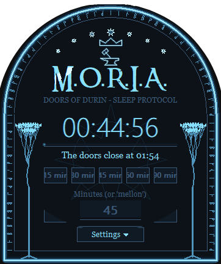

# M.O.R.I.A. — Doors of Durin Sleep Timer

*Speak, friend, and enter.* 🇹🇷 [Türkçe README](README.tr.md)



A tiny Windows tray app that shuts your PC down after a countdown — perfect for falling asleep to a
video or music. Click the tray icon and a glowing, arch-shaped panel (the Doors of Durin) slides up
next to your taskbar. Pick a time, press the button, close your eyes.

> **Status:** Windows 7 / 8 / 10 / 11. Single `.exe`, no installer, no dependencies, no admin rights.

## Features

- **Tray flyout** — opens at the tray icon, closes when you click elsewhere or press `Esc`. Never appears on the taskbar or in Alt+Tab.
- **Fast input** — presets (15 / 30 / 45 / 60 / 90 min), a custom minutes box, mouse-wheel to nudge the time by 5 minutes, `Enter` to start.
- **Clear feedback** — large countdown clock, progress bar, "doors close at 23:41", turns red in the last minute.
- **Tray integration** — icon changes color while a countdown is running, tooltip shows the remaining time, right-click menu for quick *30 / 60 / 90 min* start and *Cancel*.
- **Survives restarts of the app** — if you exit the app but keep the timer, it resumes where it left off next time. (It does **not** resume after a PC reboot.)
- **Start with Windows** (silently into the tray), English / Turkish UI (auto-detected on first run), adjustable opacity.
- **Everything is drawn in code** — the door, trees, inscription band, stars, crown, hammer and anvil are all procedural GDI drawing. No bitmaps are embedded.
- Single instance, high-DPI aware, scales down on small screens, recovers if Explorer restarts.

## Usage

| Action | How |
|---|---|
| Open the panel | Left-click the tray icon (or launch the app again) |
| Start | Choose minutes → big button or `Enter` |
| Cancel | Same button while a timer is running, or right-click tray → *Cancel* |
| Cancel any pending shutdown | Type `mellon` in the minutes box and press the button |
| Quick start | Right-click tray → *Sleep in 30 / 60 / 90 min* |
| Exit | Right-click tray → *Exit* (you are asked whether to cancel a running timer) |

> ⚠️ **Heads-up:** the app uses `shutdown.exe -s -t <seconds>`. Windows closes running applications
> when the time is up **without asking to save** — save your work before you start a timer.

## Download / Build

Grab `moria.exe` from the [Releases](../../releases) page or the latest CI artifact, or build it yourself.

### Requirements
- CMake ≥ 3.15
- Visual Studio 2019/2022 (MSVC) **or** MinGW-w64 (GCC 9+)

### MSVC
```bat
cmake -S . -B build -A x64
cmake --build build --config Release
:: -> build\Release\moria.exe
```

### MinGW-w64
```bash
cmake -S . -B build -G "MinGW Makefiles"
cmake --build build
# -> build/moria.exe
```

Sources are UTF-8; the CMake file passes `/utf-8` to MSVC automatically. If you compile by hand with
MSVC, add `/utf-8`.

### Optional title font
The title uses the *Ringbearer* font if available. It is **not** bundled (check its license
yourself). Put `ringbearer.ttf` next to `moria.exe` (or install it system-wide). Without it the title
falls back to Georgia.

## How it works

- Starting a timer runs `%SystemRoot%\System32\shutdown.exe -a` followed by `-s -t <seconds>`; cancelling runs `-a`.
- The countdown on screen is computed from the wall clock, so it cannot drift.
- Settings and the running timer are stored per-user in `HKCU\Software\MORIA`; "start with Windows" is
  `HKCU\Software\Microsoft\Windows\CurrentVersion\Run\MORIA`. No files are written.
- A saved timer is resumed only if the system boot time matches, so a reboot never triggers a surprise shutdown.

## Uninstall
Turn off *Run at Startup* in the panel's settings, exit from the tray menu, delete `moria.exe`.
Optionally remove `HKCU\Software\MORIA`.

## Project layout
```
src/main.cpp      application: window, tray, timer logic, settings
src/door_art.h    procedural Doors-of-Durin drawing (GDI)
res/              icon, manifest, version resource
tools/make_icon.py  regenerates res/moria.ico (needs Pillow)
```

## Contributing
Issues and pull requests are welcome. Please keep it dependency-free (Win32 + GDI only).

## License & disclaimer
Code: [MIT](LICENSE).

This is an unofficial, non-commercial fan project. It is not affiliated with or endorsed by the
Tolkien Estate or any rights holder of *The Lord of the Rings*. Names such as *Moria*, *Doors of
Durin*, *ithildin* and *mellon* are used as homage; all artwork is original and drawn in code.
Fonts are not distributed with this repository.
