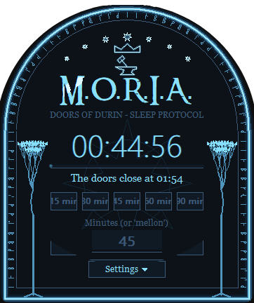

# M.O.R.I.A. — Durin'in Kapıları Uyku Zamanlayıcısı

*Söyle dost ve gir.* 🇬🇧 [English README](README.md)



Geri sayımın ardından bilgisayarı kapatan minik bir Windows tepsi uygulaması. Video ya da müzikle
uykuya dalanlar için ideal. Tepsi simgesine tıklayınca görev çubuğunun yanında parıldayan, kemer
biçimli bir panel (Durin'in Kapıları) kayarak açılır. Süreyi seç, düğmeye bas, gözlerini kapat.

> **Durum:** Windows 7 / 8 / 10 / 11. Tek `.exe`, kurulum yok, bağımlılık yok, yönetici hakkı gerekmez.

## Özellikler

- **Tepsi paneli** — simgenin yanında açılır; başka yere tıklayınca ya da `Esc` ile kapanır. Görev çubuğunda ve Alt+Tab'da görünmez.
- **Hızlı giriş** — hazır süreler (15 / 30 / 45 / 60 / 90 dk), özel dakika kutusu, fare tekerleğiyle 5'er dakika ayar, `Enter` ile başlatma.
- **Net geri bildirim** — büyük geri sayım saati, ilerleme çubuğu, "kapılar 23:41'de kapanır", son dakikada kırmızı.
- **Tepsi entegrasyonu** — geri sayım sürerken simge rengi değişir, tooltip kalan süreyi gösterir, sağ tık menüsünde *30 / 60 / 90 dk* hızlı başlatma ve *İptal* vardır.
- **Uygulama yeniden başlasa da sürer** — uygulamadan çıkıp zamanlayıcıyı bırakırsan, tekrar açtığında kaldığı yerden devam eder. (Bilgisayar yeniden başlatılırsa **devam etmez**.)
- **Windows ile başla** (sessizce tepsiye), Türkçe / İngilizce arayüz (ilk açılışta sistem dilinden), ayarlanabilir opaklık.
- **Her şey kodla çizilir** — kapı, ağaçlar, yazıt şeridi, yıldızlar, taç, çekiç ve örs tamamen GDI ile çizilir. Gömülü görsel yoktur.
- Tek örnek, yüksek DPI desteği, küçük ekranlarda otomatik küçülme, Explorer yeniden başlarsa simgenin geri gelmesi.

## Kullanım

| İşlem | Nasıl |
|---|---|
| Paneli aç | Tepsi simgesine sol tık (veya uygulamayı yeniden çalıştır) |
| Başlat | Dakikayı seç → büyük düğme ya da `Enter` |
| İptal | Zamanlayıcı çalışırken aynı düğme ya da tepsi sağ tık → *İptal* |
| Bekleyen her kapatmayı iptal et | Dakika kutusuna `mellon` yazıp düğmeye bas |
| Hızlı başlat | Tepsi sağ tık → *30 / 60 / 90 dk sonra uykuya geç* |
| Çıkış | Tepsi sağ tık → *Çıkış* (çalışan zamanlayıcı varsa iptal edilsin mi diye sorulur) |

> ⚠️ **Dikkat:** Uygulama `shutdown.exe -s -t <saniye>` kullanır. Süre dolunca Windows açık uygulamaları
> **kaydetmeden** kapatır. Zamanlayıcıyı başlatmadan önce işlerini kaydet.

## İndir / Derle

`moria.exe` dosyasını [Releases](../../releases) sayfasından ya da son CI çıktısından alabilir veya kendin derleyebilirsin.

### Gereksinimler
- CMake ≥ 3.15
- Visual Studio 2019/2022 (MSVC) **veya** MinGW-w64 (GCC 9+)

### MSVC
```bat
cmake -S . -B build -A x64
cmake --build build --config Release
:: -> build\Release\moria.exe
```

### MinGW-w64
```bash
cmake -S . -B build -G "MinGW Makefiles"
cmake --build build
# -> build/moria.exe
```

Kaynaklar UTF-8'dir; CMake, MSVC'ye `/utf-8` bayrağını otomatik verir. MSVC ile elle derlerken `/utf-8` ekle.

### İsteğe bağlı başlık fontu
Başlık, varsa *Ringbearer* fontunu kullanır. Font depoya **eklenmemiştir** (lisansını kendin kontrol et).
`ringbearer.ttf` dosyasını `moria.exe`'nin yanına koy (ya da sisteme kur). Yoksa başlık Georgia ile çizilir.

## Nasıl çalışır

- Başlatınca `%SystemRoot%\System32\shutdown.exe -a`, ardından `-s -t <saniye>` çalışır; iptal `-a` çalıştırır.
- Ekrandaki geri sayım duvar saatine göre hesaplanır, kayma yapmaz.
- Ayarlar ve çalışan zamanlayıcı kullanıcıya özel `HKCU\Software\MORIA` altında tutulur; "Windows ile başla"
  `HKCU\Software\Microsoft\Windows\CurrentVersion\Run\MORIA` anahtarıdır. Hiçbir dosya yazılmaz.
- Kayıtlı zamanlayıcı yalnızca sistem açılış zamanı eşleşirse sürdürülür; yeniden başlatma sonrası sürpriz kapanma olmaz.

## Kaldırma
Panelin ayarlarından *Windows ile Başla*'yı kapat, tepsi menüsünden çık, `moria.exe`'yi sil.
İstersen `HKCU\Software\MORIA` anahtarını da sil.

## Proje yapısı
```
src/main.cpp      uygulama: pencere, tepsi, zamanlayıcı mantığı, ayarlar
src/door_art.h    Durin Kapısı çizimleri (GDI)
res/              ikon, manifest, sürüm kaynağı
tools/make_icon.py  res/moria.ico dosyasını yeniden üretir (Pillow gerekir)
```

## Katkı
Issue ve pull request'ler memnuniyetle karşılanır. Lütfen bağımlılıksız kalsın (yalnızca Win32 + GDI).

## Lisans ve uyarı
Kod: [MIT](LICENSE).

Bu, resmî olmayan ve ticari amaç taşımayan bir hayran projesidir; Tolkien Estate'e veya *Yüzüklerin
Efendisi*'nin herhangi bir hak sahibine bağlı değildir, onlarca onaylanmamıştır. *Moria*, *Durin'in
Kapıları*, *ithildin* ve *mellon* gibi adlar saygı duruşu olarak kullanılmıştır; tüm görseller özgündür
ve kodla çizilmiştir. Yazı tipleri bu depoyla dağıtılmaz.
